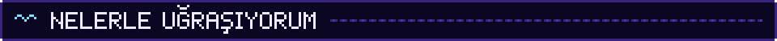
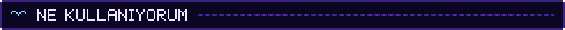
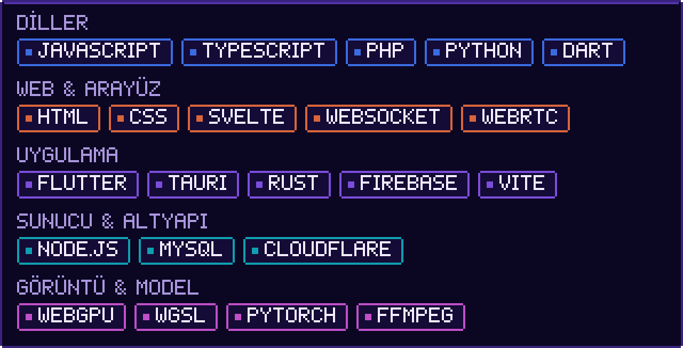
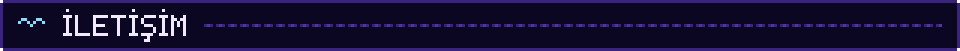
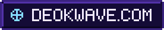
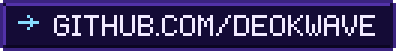
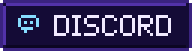

 

Selam, ben Deokwave'in kurucusuyum. [Deokwave](https://deokwave.com) Türkçe altyazılı anime izlenen bir site, Windows ve Android uygulamaları da var. Siteyle, oynatıcıyla ve uygulamalarla ben uğraşıyorum.

 

Son aylarda vaktimin çoğu oynatıcıya gidiyor. Animeler genelde saniyede 24 kare geliyor; [FPS Artırma](https://github.com/Deokwave/frame-generation) araya yeni kareler ekleyip bölümü daha akıcı oynatıyor. 120 ve 144 Hz ekranlarda takılmadan aksın diye epey uğraştım, hâlâ da uğraşıyorum.

Bir yandan da [Nami](https://github.com/Deokwave/nami-4k)'yi eğitiyorum. Nami anime için kendi 4K büyütme modelimiz, oynatıcıya Anime4K'nın yanına ikinci seçenek olarak geliyor. [Derin Renkler](https://github.com/Deokwave/frc) koyu sahnelerdeki renk bantlarını azaltıyor. Hepsi [Wavegen](https://github.com/Deokwave/wavegen) dediğimiz altyapının üstünde çalışıyor.

Uygulama tarafında Tauri ile yazdığım bir Windows uygulaması ve Flutter ile yazdığım bir Android uygulaması var, şu sıralar Android TV sürümü üzerinde de çalışıyorum.

Bir şeyi siteye koymadan önce kendim denemeyi seviyorum. Yeni bir oynatıcı sürümünü farklı ekranlarda uzun uzun izleyip ölçmeden yayınlamıyorum, Nami'yi de hiç görmediği serilerde sınıyorum. Neyi nasıl yaptığımızı her teknolojinin kendi sayfasında kısaca anlattım.

 

  

Deokwave ile ilgili bir şey için Discord sunucumuza gelebilir ya da info@deokwave.com adresine yazabilirsin.

  

 

Deokwave kapalı kaynak, kodlar burada değil.

